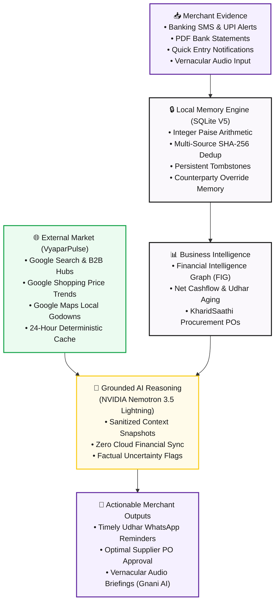

<div align="center">

<!-- HERO BADGE HEADER -->
<p align="center">
  <span style="background-color: #FACC15; color: #171717; padding: 6px 14px; font-weight: 800; font-size: 13px; border: 2px solid #171717; border-radius: 6px; box-shadow: 3px 3px 0px #171717; display: inline-block;">
    🇮🇳 BHARAT'S NEXT-GEN MSME COPILOT
  </span>
</p>

# 🟣 MeraVyapar AI
### **Your AI-Powered Financial & Market Intelligence Copilot for Indian MSMEs**
#### *Business. Money. Market. — All Connected.*

<p align="center">
  <a href="#-the-problem"></a>
  <a href="#-architecture-and-technology-stack"></a>
  <a href="#-architecture-and-technology-stack"></a>
  <a href="#-meravyapar-ai--financial-intelligence"></a>
  <a href="#-vyaparpulse--market-intelligence"></a>
  <a href="#-multilingual-experience"></a>
  <a href="#-how-it-works"></a>
</p>

<!-- DUAL HERO CHARACTER BANNER -->
<table border="0" align="center" style="border: none; background: transparent;">
  <tr>
    <td align="center" width="220" style="border: none; background: transparent;">
      <br/>
      <sub><b>Shri Ramesh Gupta</b><br/>Kirana Store Owner</sub>
    </td>
    <td align="center" style="border: none; background: transparent; padding: 0 16px;">
      <div style="background-color: #FAF8FC; border: 2.5px solid #171717; border-radius: 12px; padding: 18px 24px; box-shadow: 5px 5px 0px #5F259F; max-width: 540px; text-align: left;">
        <p style="color: #171717; font-size: 15px; line-height: 1.6; margin: 0;">
          <b>MeraVyapar AI</b> bridges the gap between daily Indian retail reality and modern enterprise intelligence. Built for India's 63+ million micro-retailers, distributors, and workshop owners, it unites <b>local financial recordkeeping</b>, <b>live external market intelligence</b>, and <b>end-to-end procurement workflows</b> into one unified, offline-first copilot.
        </p>
      </div>
    </td>
    <td align="center" width="220" style="border: none; background: transparent;">
      <br/>
      <sub><b>Smt. Priya Sharma</b><br/>Retail Store Entrepreneur</sub>
    </td>
  </tr>
</table>

<p align="center">
  <a href="#-the-problem"><b>Problem</b></a> •
  <a href="#-our-solution-the-three-connected-pillars"><b>Three Pillars</b></a> •
  <a href="#-1-meravyapar-ai--financial-intelligence"><b>Financial Core</b></a> •
  <a href="#-2-vyaparpulse--market-intelligence"><b>VyaparPulse</b></a> •
  <a href="#-3-kharidsaathi--procurement-intelligence"><b>KharidSaathi</b></a> •
  <a href="#-how-it-works-the-information-flow"><b>How It Works</b></a> •
  <a href="#%EF%B8%8F-architecture-and-technology-stack"><b>Architecture</b></a> •
  <a href="#-getting-started"><b>Quickstart</b></a>
</p>

</div>

---

## ⚡ The Problem Faced by Indian MSMEs

India's retail economy runs on trust, fast inventory turnover, and unwritten customer credit (*udhar*). Despite digital payment revolutions like UPI, small business owners still struggle with fragmented tools, cognitive overload, and zero market leverage.

<table border="0" width="100%">
  <tr>
    <td width="30%" align="center" valign="top">
      <br/>
      <b>Scattered Records</b>
      <p><i>Ledgers split across paper bahi-khatas, cash registers, and disparate UPI apps.</i></p>
    </td>
    <td width="30%" align="center" valign="top">
      <br/>
      <b>Untracked Udhar & Promises</b>
      <p><i>"Bhaiya kal shaam ko bhejta hoon" — verbal promises forgotten, trapping working capital.</i></p>
    </td>
    <td width="30%" align="center" valign="top">
      <br/>
      <b>Procurement Blindspots</b>
      <p><i>Buying inventory without benchmark wholesale prices or landed-cost breakdowns.</i></p>
    </td>
  </tr>
</table>

### Critical Friction Points

| Challenge | Real-World Impact on Small Business Owners |
|:---|:---|
| 📑 **Fragmented Records** | Transactions are split between physical cash drawers, WhatsApp notes, UPI soundboxes, and bank SMS alerts. Daily cash positions remain a blind guess. |
| ⏳ **Delayed Payments & Bad Debt** | Up to 40% of micro-business capital remains locked in uncollected credit (*udhar*). Merchants lack structured payment aging and gentle collection reminders. |
| 🗣️ **Vanishing Payment Promises** | Customers promise payment dates verbally or over call. Without automatic capture and calendar tracking, merchants fail to follow up on time. |
| 📦 **Blind Procurement Decisions** | Sourcing stock from local middlemen without knowing true manufacturer rates, MOQ conditions, or landed logistics costs. |
| 🌐 **Zero Real-Time Market Sight** | Big retail chains use automated scrapers and price bots; MSMEs have zero visibility into regional commodity movements or nearby supplier wholesale quotes. |
| 🧩 **Inaccessible Desktop ERPs** | Heavy accounting tools (Tally, Zoho) require desktop computers and accounting degrees. Merchants need an intuitive mobile experience in their own language. |

---

## 💡 Our Solution: The Three Connected Pillars

MeraVyapar AI transforms business operations by binding **internal transaction reality**, **external market signals**, and **structured procurement** into a single cohesive system.

```
       ┌─────────────────────────────────────────────────────────────┐
       │                      MERAVYAPAR AI                          │
       │    Your Unified Financial & Market Intelligence System      │
       └──────────────────────────────┬──────────────────────────────┘
                                      │
         ┌────────────────────────────┼────────────────────────────┐
         │                            │                            │
         ▼                            ▼                            ▼
  🟣 MERAVYAPAR AI             💚 VYAPARPULSE               💛 KHARIDSAATHI
  Financial Intelligence       Market Intelligence          Procurement Intelligence
  ──────────────────────       ───────────────────          ────────────────────────
  • Device SQLite (V5)         • Live Google Search         • Purchase Requests
  • Integer-Paise Precision    • Google Shopping Trends     • Supplier Multi-Quotes
  • Udhar & Promises Memory    • Regional Commodity News    • Landed-Cost Arithmetic
  • Financial Graph (FIG)      • Google Maps Suppliers      • Purchase Orders & Debt
```

<table border="0" width="100%">
  <tr>
    <td width="33%" align="center" valign="top">
      <br/>
      <span style="background-color: #5F259F; color: #FFFFFF; padding: 4px 10px; font-weight: 700; border-radius: 4px; font-size: 12px;">PILLAR 1</span>
      <h4>🟣 MeraVyapar AI</h4>
      <p align="left"><b>Financial Core</b>: On-device ACID ledger, integer-paise math, automated UPI notification capture, receivables aging, and counterparty memory.</p>
    </td>
    <td width="33%" align="center" valign="top">
      <br/>
      <span style="background-color: #16A34A; color: #FFFFFF; padding: 4px 10px; font-weight: 700; border-radius: 4px; font-size: 12px;">PILLAR 2</span>
      <h4>💚 VyaparPulse</h4>
      <p align="left"><b>Market Pulse</b>: Real-time external supplier discovery, commodity trend analysis, and regional price intelligence powered by cached SerpApi queries.</p>
    </td>
    <td width="33%" align="center" valign="top">
      <br/>
      <span style="background-color: #FACC15; color: #171717; padding: 4px 10px; font-weight: 700; border-radius: 4px; font-size: 12px;">PILLAR 3</span>
      <h4>💛 KharidSaathi</h4>
      <p align="left"><b>Smart Buying</b>: Structured purchasing requests, multi-supplier quote comparisons, landed-cost optimization, and automated accounts-payable sync.</p>
    </td>
  </tr>
</table>

---

## 🟣 1. MeraVyapar AI — Financial Intelligence

The foundation of MeraVyapar AI is a zero-latency, local-first transaction ledger that guarantees complete financial accuracy without exposing merchant data to cloud risks.

<table border="0" width="100%">
  <tr>
    <td width="65%" valign="top">
      <h3>Accurate Money In / Money Out & Udhar Tracking</h3>
      <ul>
        <li><b>Canonical Transaction Ledger</b>: Operates entirely inside an on-device SQLite database (<code>meravyapar_local.db</code>) with Write-Ahead Logging (WAL) and strict foreign key constraints.</li>
        <li><b>Strict Integer-Paise Invariant</b>: All monetary figures are stored as integer minor units (<code>BIGINT amount_minor_units</code>). Zero floating-point rounding errors — ₹1,499.50 is strictly stored as <code>149950</code> paise.</li>
        <li><b>SpendSense-Inspired Capture Pipeline</b>: Native Android <code>FinancialNotificationListenerService</code> captures inbound payments from Google Pay, PhonePe, Paytm, and BHIM in real-time.</li>
        <li><b>Persistent Deletion Tombstones</b>: If a merchant deletes an auto-parsed transaction, its cryptographic signature is saved to <code>financial_evidence_tombstones</code> so background resyncs never resurrect it.</li>
        <li><b>Counterparty Feedback Memory</b>: Merchant-edited tags and business categories are permanently remembered in <code>counterparty_overrides</code> and auto-applied to future transactions.</li>
        <li><b>Receivables & Payment Promises</b>: Automatically tracks expected customer payments, agreed settlement dates, and payment history.</li>
      </ul>
    </td>
    <td width="35%" align="center" valign="middle">
      <br/>
      <sub><b>Automated Receivables Memory</b><br/>Never miss an overdue customer promise.</sub>
    </td>
  </tr>
</table>

<table border="0" width="100%">
  <tr>
    <td width="35%" align="center" valign="middle">
      <br/>
      <sub><b>Instant UPI Soundbox & QR Sync</b><br/>Zero manual typing; verified against bank UTR.</sub>
    </td>
    <td width="65%" valign="top">
      <h3>SpendSense Evidence Extraction & Noise Filtering</h3>
      <ul>
        <li><b>Deterministic Regex Parsing</b>: Extracts credited/debited amounts, UPI sender handles, bank reference numbers (UTR), and masked account numbers.</li>
        <li><b>Strict Non-Transaction Shield</b>: Automatically filters out OTP messages, promotional marketing, balance inquiries, and failed payment alerts.</li>
        <li><b>Notification Shade Quick Entry</b>: Merchants can record offline cash transactions directly from the Android pull-down shade via <code>RemoteInput</code> without opening the app.</li>
        <li><b>SAF Bank Statement Ingestion</b>: Seamlessly imports PDF statements via Android's Storage Access Framework, validating file signatures against path traversal attacks.</li>
      </ul>
    </td>
  </tr>
</table>

### Financial Intelligence Graph (FIG)

Instead of flat, isolated rows, MeraVyapar AI dynamically compiles an on-device directional entity graph:

```
 [ Merchant Business ]
          │
          ├── (1:N) ──► [ Counterparties ] (Customers & Vendors)
          │                    │
          │                    ├── (1:N) ──► [ Payment Promises ] (Due Dates & UTRs)
          │                    └── (1:N) ──► [ Canonical Transactions ] (Integer Paise)
          │
          └── (1:N) ──► [ Procurement Obligations ] ──► [ Purchase Orders ]
```

- **Net Cash Position**: Evaluated directly from confirmed credits and debits.
- **Counterparty Risk Score**: Measures how reliably a customer honors payment promises over a 90-day window.
- **Priority Action Engine**: Highlights top collection actions and critical debt obligations each morning.

---

## 💚 2. VyaparPulse — Market Intelligence

Small merchants often buy from local monopolistic suppliers because searching regional wholesale hubs takes too much time. **VyaparPulse** provides an external market intelligence layer powered by SerpApi.

<table border="0" width="100%">
  <tr>
    <td width="35%" align="center" valign="middle">
      <br/>
      <sub><b>Real-Time Sourcing Pulse</b><br/>Discover suppliers across wholesale hubs.</sub>
    </td>
    <td width="65%" valign="top">
      <h3>External Grounding Across 4 Search Dimensions</h3>
      <ul>
        <li>🔍 <b>Google Search Engine</b>: Finds wholesale distributors, B2B supplier directories, and trade manufacturing networks across India (e.g., Surat textiles, Mandi grain hubs).</li>
        <li>🛒 <b>Google Shopping Engine</b>: Retrieves current retail and commercial price listings to prevent inventory overpayment.</li>
        <li>📰 <b>Google News Engine</b>: Scans regional trade news for commodity price spikes (edible oils, pulses, steel, cement) and transportation strikes.</li>
        <li>📍 <b>Google Maps Engine</b>: Pinpoints local physical suppliers, transport godowns, operating hours, and verified contact numbers.</li>
      </ul>
      <div style="background-color: #F5F0FF; border: 2px solid #5F259F; border-radius: 8px; padding: 12px 16px; margin-top: 10px;">
        <b style="color: #3C1361;">🛡️ Strict Epistemic Boundaries Enforced:</b>
        <p style="color: #171717; font-size: 13px; margin: 4px 0 0 0;">
          • <b>Discovered Listings ≠ Verified Suppliers</b>: External search results are labeled as unverified leads until formal contact.<br/>
          • <b>Web Listing Prices ≠ Trade Quotes</b>: Public retail prices serve strictly as market benchmarks. Formal procurement requires binding quotes covering taxes, freight, and credit terms.
        </p>
      </div>
    </td>
  </tr>
</table>

---

## 💛 3. KharidSaathi — Procurement Intelligence

**KharidSaathi** streamlines the procurement lifecycle from purchase requisition to final accounts-payable entry, protecting margins from hidden freight and tax costs.

<table border="0" width="100%">
  <tr>
    <td width="65%" valign="top">
      <h3>The Complete 6-Stage Sourcing Workflow</h3>
      <ol>
        <li><b>Purchase Request</b>: Create itemized restocking demands with required delivery windows and estimated target quantities.</li>
        <li><b>Supplier Assignment</b>: Link internal trusted suppliers or newly discovered VyaparPulse leads to the requisition.</li>
        <li><b>Quotation Collection</b>: Capture multiple supplier bids with base prices, minimum order quantities (MOQ), and payment credit terms.</li>
        <li><b>Deterministic Landed-Cost Optimization</b>: Calculates exact total cost per unit in integer paise, accounting for GST and logistics.</li>
        <li><b>Purchase Order Dispatch</b>: Generates official, numbered purchase orders ready for WhatsApp or PDF distribution.</li>
        <li><b>Obligation & Payable Auto-Sync</b>: Confirmed POs automatically create pending supplier obligations in the local financial ledger.</li>
      </ol>
    </td>
    <td width="35%" align="center" valign="middle">
      <br/>
      <sub><b>Stock & Order Verification</b><br/>Audited inventory matching binding POs.</sub>
    </td>
  </tr>
</table>

### Landed-Cost Calculation Formula

$$\text{Total Landed Cost (paise)} = (\text{Unit Price} \times \text{Qty}) + \text{GST (paise)} + \text{Freight (paise)} + \text{Additional Charges (paise)}$$

```
Supplier A: ₹100/kg  + ₹18 GST + ₹12 Freight  = ₹130/kg landed cost
Supplier B: ₹108/kg  + ₹05 GST + ₹00 Freight  = ₹113/kg landed cost  ◄── BEST BID REVEALED
```
*KharidSaathi reveals when an apparently higher base price is actually cheaper once shipping and packaging fees are included.*

<table border="0" width="100%">
  <tr>
    <td width="35%" align="center" valign="middle">
      <br/>
      <sub><b>PO Dispatch & Logistics</b><br/>Connecting landed cost quotes to verified delivery.</sub>
    </td>
    <td width="65%" valign="top">
      <h3>Purchase Order Generation & Logistics Reconciliation</h3>
      <p>Once the optimal quotation is selected, KharidSaathi generates an immutable Purchase Order (PO) with embedded item specifications, agreed tax rates, and delivery addresses.</p>
      <ul>
        <li><b>Automated Vendor Dispatch</b>: Instant sharing via WhatsApp or standardized PDF format.</li>
        <li><b>Payables & Obligation Invariant</b>: PO approval atomically registers a pending accounts-payable record in <code>procurement_supplier_obligations</code>.</li>
        <li><b>Fulfillment Tracking</b>: Tracks partial deliveries and flags freight cost variances against original bids.</li>
      </ul>
    </td>
  </tr>
</table>

---

## 🔄 How It Works: The Information Flow

Data flows from unstructured merchant evidence into verified on-device memory, is enriched with external market trends, and feeds grounded AI reasoning.



<div align="center">
  
  <p><sub><b>MeraVyapar Autonomous AI Engine</b>: Grounded reasoning with zero cloud leakage of financial books.</sub></p>
</div>

---

## 🏛️ Architecture and Technology Stack

The repository uses a dual-tier architecture: an **offline-first local client** holding canonical truth, paired with a **stateless FastAPI backend gateway** for external intelligence and speech processing.

```
┌─────────────────────────────────────────────────────────────────────────────┐
│                       FLUTTER CLIENT (frontend/)                            │
│                                                                             │
│  [ UI Screens: Home, Ledger, Receivables, KharidSaathi, VyaparPulse ]       │
│                                    │                                        │
│  [ Riverpod State Management ] ◄───┼───► [ Local Evidence Capture ]         │
│                                    │        • Notification Listener Service │
│                                    │        • SAF File Statement Picker     │
│                                    │        • Android Quick Entry Bridge    │
│                                    ▼                                        │
│   ┌──────────────────────────────────────────────────────────────────────┐  │
│   │             CANONICAL ON-DEVICE DATABASE (SQLite V5)                 │  │
│   │             File: meravyapar_local.db  | Mode: WAL                   │  │
│   │  • canonical_transactions            • payment_promises              │  │
│   │  • procurement_suppliers             • procurement_quotations        │  │
│   │  • financial_evidence_tombstones     • counterparty_overrides        │  │
│   └──────────────────────────────────────────────────────────────────────┘  │
└──────────────────────────────────────┬──────────────────────────────────────┘
                                       │ Sanitized Context (No Raw DB Sync)
                                       ▼ HTTPS (15s Structured Timeout)
┌─────────────────────────────────────────────────────────────────────────────┐
│                 STATELESS FASTAPI GATEWAY (backend/)                        │
│                                                                             │
│  [ Gateway Endpoints: /health, /voice, /market-intelligence, /assistant ]   │
│                                    │                                        │
│        ┌───────────────────────────┼───────────────────────────┐            │
│        ▼                           ▼                           ▼            │
│ ┌───────────────┐         ┌─────────────────┐         ┌───────────────────┐ │
│ │   Gnani AI    │         │     SerpApi     │         │  NVIDIA Nemotron  │ │
│ │ Prisma (STT)  │         │ Google Shopping │         │  3.5 Lightning    │ │
│ │ Timbre (TTS)  │         │ Search & Maps   │         │  via OpenRouter   │ │
│ └───────────────┘         └─────────────────┘         └───────────────────┘ │
└─────────────────────────────────────────────────────────────────────────────┘
```

### Verified Technology Stack

| Layer | Technology | Version | Purpose in MeraVyapar AI |
|:---|:---|:---|:---|
| **Mobile Client** | **Flutter / Dart** | `SDK >=3.0 <4.0` | High-performance Android & cross-platform reactive mobile application. |
| **State Management** | **Flutter Riverpod** | `^2.5.1` | Predictable, compile-safe dependency injection and reactive state. |
| **Canonical Database** | **SQLite (sqflite)** | `^2.3.0` | On-device ACID relational storage with WAL, FKs, and schema migrations (V1→V5). |
| **Evidence Security** | **Crypto & Secure Storage** | `^3.0.7` / `^9.0.0` | PBKDF2-HMAC-SHA256 encrypted backups (`.mvbak`) and AES key storage. |
| **Backend Gateway** | **FastAPI** | `0.110.0` | Asynchronous, stateless REST gateway for external AI orchestration. |
| **ASGI Server** | **Uvicorn** | `0.28.0` | High-throughput asynchronous server running the FastAPI gateway. |
| **Market Intelligence** | **SerpApi Client** | Direct HTTPX | Google Search, Shopping, Maps, and News scraper with 24-hr TTL caching. |
| **AI Reasoning** | **NVIDIA Nemotron** | `3.5-lightning` | Grounded financial reasoning via OpenRouter without raw ledger exposure. |
| **Voice & Speech** | **Gnani Vachana AI** | `prisma / timbre` | Low-latency Indic Speech-to-Text and Text-to-Speech across 11 Indian languages. |
| **Testing Harness** | **Pytest & Flutter Test** | `8.1.1` / Dart SDK | 104 verified automated tests across backend services and Flutter logic. |

---

## 🔒 Privacy, Integrity & Data Sovereignty

Financial records represent a merchant's most confidential asset. MeraVyapar AI follows a local-first privacy model:

<table border="0" width="100%">
  <tr>
    <td width="30%" align="center" valign="middle">
      <br/>
      <sub><b>Local Data Sovereignty</b><br/>Your financial ledger never leaves your device.</sub>
    </td>
    <td width="70%" valign="top">
      <ul>
        <li>🛡️ <b>Local-First Storage</b>: Financial transactions, counterparties, and payment promises are stored solely in on-device SQLite. There is zero background database synchronization to cloud databases.</li>
        <li>🔢 <b>Exact Integer Arithmetic</b>: Eliminates double-precision rounding drift by calculating every transaction, quote, and obligation in integer paise.</li>
        <li>🔐 <b>Encrypted Backup Archive</b>: Exportable <code>.mvbak</code> backups are encrypted using PBKDF2-HMAC-SHA256 key derivation with AES-GCM data containers.</li>
        <li>🧼 <b>Search Sanitization</b>: External SerpApi requests strip all merchant identifiers, bank account numbers, UTRs, and personal names.</li>
        <li>🤖 <b>Grounded Context Snapshots</b>: The AI assistant receives only sanitized metric summaries. It does not ingest raw transaction databases.</li>
        <li>🔕 <b>Android Permission Hygiene</b>: Uses Android's modern <code>NotificationListenerService</code> and SAF document picker. Avoids legacy, dangerous <code>READ_SMS</code> permissions that risk Play Store rejection.</li>
      </ul>
    </td>
  </tr>
</table>

---

## 🗣️ Multilingual Experience for Bharat

India's retail economy speaks multiple languages. MeraVyapar AI pairs regional language interfaces with voice interaction powered by **Gnani AI**:

<table border="0" width="100%">
  <tr>
    <td width="65%" valign="top">
      <h3>Native Indic Voice & Vernacular Accessibility</h3>
      <p>Merchants can speak in their mother tongue to log sales, verify customer udhar, or ask for supplier price trends.</p>
      <div style="background-color: #FAF8FC; border: 2px solid #171717; border-radius: 8px; padding: 12px; box-shadow: 3px 3px 0px #5F259F;">
        <b>Supported Dialects & Locales:</b>
        <p style="margin: 6px 0 0 0; font-size: 14px;">
          🇮🇳 <b>हिन्दी (Hindi)</b> • <b>मराठी (Marathi)</b> • <b>English (Indian)</b> • <b>தமிழ் (Tamil)</b> • <b>తెలుగు (Telugu)</b> • <b>ಕನ್ನಡ (Kannada)</b> • <b>ગુજરાતી (Gujarati)</b> • <b>বাংলা (Bengali)</b> • <b>ਪੰਜਾਬੀ (Punjabi)</b>
        </p>
      </div>
      <ul>
        <li><b>Speech-to-Text (STT)</b>: Powered by Gnani Prisma (<code>prisma-v2.5</code>), tuned for retail ambient noise.</li>
        <li><b>Text-to-Speech (TTS)</b>: Natural audio playback with the regional Nalini voice model (<code>timbre-v2.5</code>).</li>
        <li><b>Voice-Activated Entry</b>: Convert spoken phrases like *"Ramesh ne ₹500 diye"* directly into verified ledger entries.</li>
      </ul>
    </td>
    <td width="35%" align="center" valign="middle">
      <br/>
      <sub><b>Vernacular First</b><br/>Built for Tier-2, Tier-3 and rural markets.</sub>
    </td>
  </tr>
</table>

---

## 📱 Product Architecture & Screen Directory

The Flutter application provides a focused, high-contrast user experience across key operational workflows:

```
frontend/lib/features/
 ├── home/                  ──► HomeShellScreen & Dashboard (Net cash, quick actions, daily summary)
 ├── transactions/          ──► CanonicalTransactionsScreen (ACID ledger, paise filter, search)
 ├── capture/               ──► EvidenceCaptureScreen (Notification status, PDF statement import)
 ├── events/                ──► ReceivablesScreen & PaymentPromisesScreen (Udhar calendar & aging)
 ├── procurement/           ──► ProcurementDashboard, QuotationComparisonScreen & PO Creator
 ├── market_intelligence/   ──► VyaparPulseScreen (Live Google Search, Shopping & Maps intelligence)
 ├── intelligence/          ──► UnifiedFinancialIntelligenceScreen & MerchantAssistantScreen (Nemotron AI)
 └── memory/                ──► BusinessProfileScreen & CounterpartyMemoryScreen
```

<table border="0" width="100%">
  <tr>
    <td width="25%" align="center">
      <div style="border: 2px solid #171717; border-radius: 8px; padding: 8px; background: #FAF8FC;">
        <b>📊 Cashflow & Ledger</b><br/>
        <sub>Real-time Money In / Money Out with one-tap filtering.</sub>
      </div>
    </td>
    <td width="25%" align="center">
      <div style="border: 2px solid #171717; border-radius: 8px; padding: 8px; background: #FAF8FC;">
        <b>⏳ Udhar Calendar</b><br/>
        <sub>Promised payment dates with auto-reminders via WhatsApp.</sub>
      </div>
    </td>
    <td width="25%" align="center">
      <div style="border: 2px solid #171717; border-radius: 8px; padding: 8px; background: #FAF8FC;">
        <b>🛒 KharidSaathi Hub</b><br/>
        <sub>Multi-supplier bids with landed-cost breakdowns.</sub>
      </div>
    </td>
    <td width="25%" align="center">
      <div style="border: 2px solid #171717; border-radius: 8px; padding: 8px; background: #FAF8FC;">
        <b>🤖 AI Merchant Copilot</b><br/>
        <sub>Conversational business advice powered by Nemotron 3.5.</sub>
      </div>
    </td>
  </tr>
</table>

---

## 🚀 Getting Started

Follow these instructions to run the stateless gateway and the Flutter mobile app locally.

### Prerequisites

- **Python**: Version `3.10` or higher
- **Flutter**: Version `3.19.x` or higher (Channel `stable`)
- **Android Studio / SDK**: Android SDK API Level 21 to 36
- **Git**

---

### 1. Backend Gateway Setup

```bash
# 1. Navigate to the backend directory
cd backend

# 2. Create and activate a virtual environment
python -m venv venv
# On Windows:
.\venv\Scripts\activate
# On Linux/macOS:
source venv/bin/activate

# 3. Install dependencies
pip install -r requirements.txt

# 4. Configure environment variables
cp .env.example .env
# Edit .env with your credentials (see Configuration section below)

# 5. Start the FastAPI gateway server
uvicorn app.main:app --host 0.0.0.0 --port 8000 --reload
```

The gateway Swagger UI will be available at: `http://localhost:8000/docs`

---

### 2. Frontend Mobile Setup

```bash
# 1. Navigate to the frontend directory
cd frontend

# 2. Fetch Flutter packages
flutter pub get

# 3. Verify Flutter environment
flutter doctor

# 4. Launch on a connected Android phone or emulator
flutter run
```

---

### 3. Build Production Android Release APK

```bash
cd frontend
flutter build apk --release --dart-define=API_BASE_URL=https://meravyapar-ai.onrender.com/api/v1
```
*Compiled APK output will be located at: `frontend/build/app/outputs/flutter-apk/app-release.apk`*

---

### Environment Configuration Reference (`.env`)

| Variable | Description | Default / Example |
|:---|:---|:---|
| `ENVIRONMENT` | Gateway runtime mode | `development` |
| `API_BASE_URL` | Base host URL for client calls | `http://localhost:8000` |
| `SERPAPI_API_KEY` | SerpApi key for Google Shopping, Search & News | `your_serpapi_key` |
| `SERPAPI_CACHE_TTL_SECONDS` | Deterministic cache duration for search results | `86400` (24 Hours) |
| `OPENROUTER_API_KEY` | OpenRouter key for NVIDIA Nemotron reasoning | `your_openrouter_key` |
| `FINANCIAL_INTELLIGENCE_MODEL` | Grounded reasoning model ID | `nvidia/nemotron-3.5-lightning:free` |
| `GNANI_API_KEY` | Gnani Vachana AI Key ID for Indic voice stack | `your_gnani_key` |
| `GNANI_DEFAULT_LANGUAGE` | Default vernacular language code | `hi-IN` |
| `EXTERNAL_PROVIDER_MODE` | Integration mode for actions | `simulation` |

---

## 📂 Project Structure

```
MeraVyapar AI/
├── backend/                              # Stateless FastAPI Backend Gateway
│   ├── app/
│   │   ├── api/v1/endpoints/             # REST endpoints (health, voice, market, assistant)
│   │   ├── core/                         # Config, security, logging, exceptions
│   │   ├── gateway/                      # External provider integrations (Gnani, SerpApi, Nemotron)
│   │   └── main.py                       # FastAPI application entry point
│   ├── tests/                            # Pytest automated test suite (68 passing tests)
│   └── requirements.txt                  # Python runtime dependencies
│
├── frontend/                             # Flutter Mobile Application
│   ├── android/                          # Native Android runner & NotificationListenerService
│   ├── lib/
│   │   ├── core/                         # Router, theme, local database, encrypted backup
│   │   │   ├── database/                 # SQLite Schema V5, DDL migrations, integer math
│   │   │   └── security/                 # PBKDF2-HMAC-SHA256 encrypted .mvbak backup engine
│   │   ├── features/                     # Feature modules (ledger, promises, procurement, market)
│   │   └── main.dart                     # Flutter application entry point
│   ├── test/                             # Flutter unit & integration tests (36 passing tests)
│   └── pubspec.yaml                      # Flutter dependencies and assets
│
├── docs/                                 # Documentation & Character Cutout Assets
│   └── assets/readme/characters/         # 18 individual character cutout illustrations
│
├── docker-compose.yml                    # Local multi-service orchestrator
└── README.md                             # Project landing documentation
```

---

## 🗺️ Roadmap and Future Scope

<table border="0" width="100%">
  <tr>
    <td width="70%" valign="top">
      <h3>Implemented & Production Verified (Current)</h3>
      <ul>
        <li>✅ <b>Offline-First SQLite Ledger (Schema V5)</b> with strict integer-paise math and WAL mode.</li>
        <li>✅ <b>SpendSense Capture Engine</b>: Android notification listener, UTR regex extraction, and SAF bank statement import.</li>
        <li>✅ <b>Anti-Resurrection Tombstones</b> and counterparty categorization memory.</li>
        <li>✅ <b>KharidSaathi Landed-Cost Engine</b> with GST, freight, and multi-supplier bid comparison.</li>
        <li>✅ <b>VyaparPulse Market Intelligence</b> with 24-hour deterministic SerpApi caching across Google Search, Shopping, Maps, and News.</li>
        <li>✅ <b>Indic Speech Stack</b>: Gnani Prisma STT & Timbre TTS across Hindi, Marathi, and English.</li>
        <li>✅ <b>Encrypted Backup Vault</b>: PBKDF2-HMAC-SHA256 + AES-GCM <code>.mvbak</code> container export.</li>
      </ul>
      <h3>Planned Capabilities (Future Milestones)</h3>
      <ul>
        <li>⏳ <b>ONDC Protocol Gateway</b>: Direct buyer/seller registration on the Open Network for Digital Commerce.</li>
        <li>⏳ <b>Automated GST Return Preparation</b>: One-tap export of verified GSTR-1 and GSTR-3B monthly JSON files.</li>
        <li>⏳ <b>Account Aggregator (AA) Integration</b>: Direct consent-based bank statement sync via Sahamati framework.</li>
        <li>⏳ <b>Peer-to-Peer Supplier Credit Network</b>: Reputation-backed credit terms between trusted local merchants.</li>
      </ul>
    </td>
    <td width="30%" align="center" valign="middle">
      <br/>
      <sub><b>Future Compliance</b><br/>Toward automated GST & formal credit access.</sub>
    </td>
  </tr>
</table>

---

<div align="center">


## **Empowering India's small businesses with connected financial and market intelligence.**

<p align="center">
  <span style="background-color: #5F259F; color: #FFFFFF; padding: 6px 14px; font-weight: 800; font-size: 13px; border: 2px solid #171717; border-radius: 6px; box-shadow: 3px 3px 0px #171717; display: inline-block;">
    MeraVyapar AI • Built for Bharat 🇮🇳
  </span>
</p>

</div>
