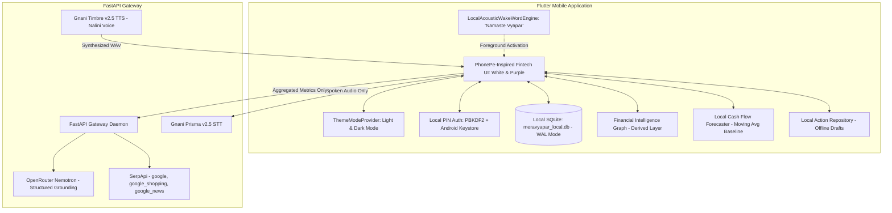

# MeraVyapar AI — Technical Architecture
## Technical Architecture & Privacy-by-Design

### Architectural Principles
- **Canonical Financial Authority**: Local SQLite is the sole source of financial truth. FastAPI has zero persistence.
- **Privacy Barrier**: Bank account numbers, full UTRs, and raw SMS are never transmitted to external providers.
- **Deterministic Math**: Calculations use integer minor units (paise). Floating point drift is eliminated.
- **Encrypted Local Backup**: AES-256-GCM authenticated encryption with PBKDF2 (60,000 rounds) key derivation and crash recovery rollback.
